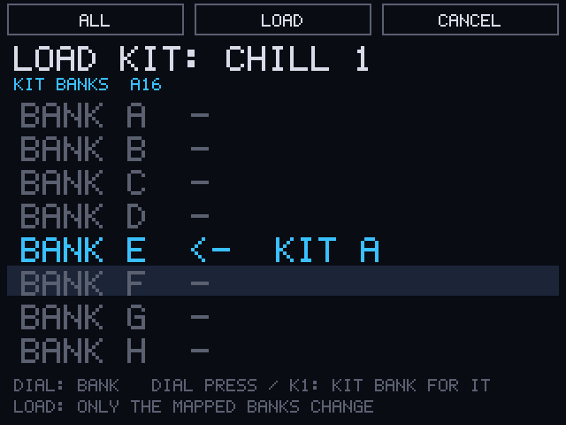
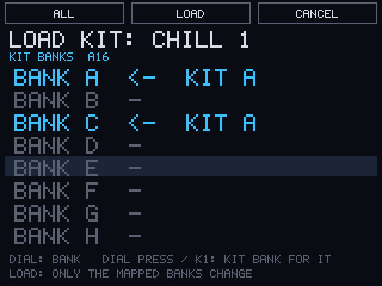
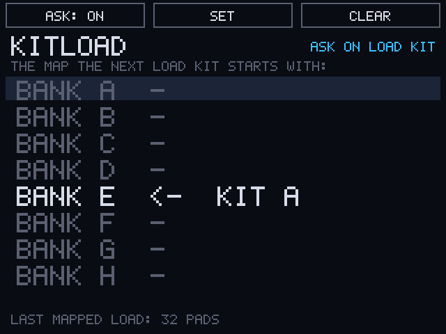
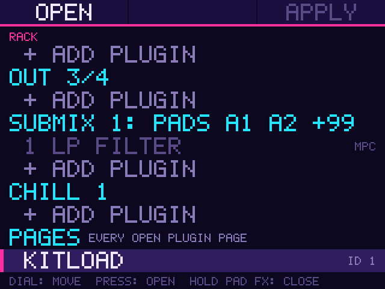

# mpc-addin-sample-kitload

An addin for the MPC Sample that loads a kit bank by bank. Stock Load Kit replaces the whole drum program and clears the
sample pool, so every bank comes from the kit. With this addin, B3 Load Kit first opens the KITLOAD page, where you put
the kit's banks onto the banks you choose. Only those banks change. Every other pad keeps its sample and its settings.

 

Captured on an MPC Sample with the draw handler's `/snap`.

## Using it

Pick a kit in Load Project and press B3 Load Kit. The page shows the kit's name, the banks it fills (`KIT BANKS A16 B16`)
and one row per bank of your project. Turn the dial to pick a row; a dial press (or K1) steps the kit bank that goes
there, and `-` leaves the bank alone. Then press one of B1 to B3, along the top of the screen:

- ALL loads the whole kit, exactly as MPC does without the addin.
- LOAD changes only the mapped banks. The sample pool isn't cleared, so your other pads keep their samples.
- CANCEL loads nothing, and its undo does nothing either. Holding PAD FX while the page is up cancels too.

The next Load Kit starts with the map you last loaded with. Undo and redo are MPC's own: undo puts the whole drum program
back as it was before the load, and redo repeats the same mapped load.

When no kit is waiting, KITLOAD opens from RACK's page list (mpc-addin-sample-rack) as a settings view. ASK ON/OFF turns
the page off (Load Kit then works as stock), and SET and CLEAR edit the map the next Load Kit starts with.

## Limits

It only runs on MPC Sample firmware 1.4.0. The addin checks every address it patches before it patches anything; on
any other firmware it stays off and Load Kit is unchanged. Program-wide settings (the drum program's own values, not the
pads') still come from the kit, as they do with stock Load Kit. After a mapped load, samples that no pad uses any more
stay in the pool until you purge it. A kit is whatever MPC's Load Kit loads: an MPC Sample project (`.xpj`).

It needs mpc-addin-sample-draw-handler 1.1.1 or later for the page.

## How it works

MPC preloads the addin (`LD_PRELOAD`), and the addin hooks Load Kit's own commands (`src/hooks.c`).
`LoadProjectAsKitCommand::execute` waits on MPC's main thread while the page asks; the buttons still reach the page
through the draw handler. If the page can't get the screen, or loses it before you answer, that Load Kit is cancelled
so MPC never sits waiting. For LOAD, the addin skips the sample-pool clear, and the drum import gives each mapped pad the
pad at the same position in its kit bank. Every other pad is copied back from the program the load replaced (MPC keeps
it for undo) through MPC's own pad export and import.

## Settings

`mpc_sample_kitload.conf`, next to the library, which the page writes: `ask` (1: B3 stops at the page, 0: Load Kit as
MPC does it) and `map` (`KITBANK:PROJECTBANK,...`, e.g. `A:C,B:D`).

## Install

Install mpc-addin-sample-draw-handler first. Download the zip from the
[releases](https://github.com/jacob-sabella/mpc-addin-sample-kitload/releases), copy the unpacked folder to the device and
run `sh install.sh` in it. The installer is the shared one from mpc-vst-plugins (`tools/release/addin`).

## Develop

`build-aarch64.sh` builds `build/aarch64/mpc_sample_kitload.so` with the aarch64 cross compiler, or in an arm64
container without one. `tools/release-aarch64.sh <version>` packages the release zip. `src/sample_draw.h` is the draw
handler's client header, the same copy mpc-addin-sample-rack uses.

## License

MIT.
